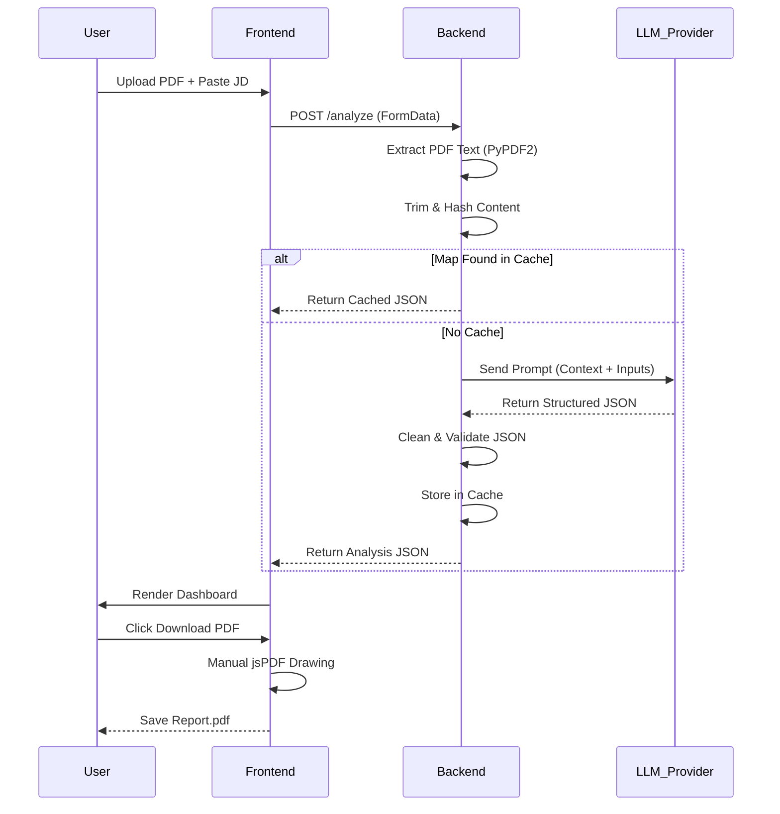

# AI Resume Analyzer & ATS Scorer | Technical Analysis

**Project Name:** AI Resume Analyzer & ATS Scorer  
**Version:** 2.1.0 (Premium SaaS Edition)  
**Status:** MVP Plus (Feature Complete)

---

## 1. Executive Summary

### The Problem
In the modern job market, **Applicant Tracking Systems (ATS)** are the first gatekeepers. Job seekers often fail to bypass these systems not due to lack of skill, but due to poor alignment between their resume and the job description (JD). Traditional feedback is either slow (human recruiters) or generic (static keyword checkers).

### The Solution
The **AI Resume Analyzer** is a high-fidelity, full-stack application that provides **Neural Alignment Analysis**. By leveraging Large Language Models (LLMs) via NVIDIA NIM, it provides an instant ATS compatibility score, identifies critical keyword gaps, and offers actionable recruiter-style advice.

---

## 2. Technical Architecture

### 2.1 Frontend: Premium SaaS Experience
The frontend is built for speed and aesthetic excellence, adhering to a "SaaS Light Mode" design system.

- **Core Stack**: React 18 + Vite (for instantaneous HMR).
- **Design System**: Tailwind CSS v4 + Framer Motion. 
    - **Typography**: Optimized for readability using `Segoe UI` and `Aptos`.
    - **Interactions**: Glassmorphism overlays, skeleton states for pre-load feedback, and "Laser Scanning" animations during AI processing.
- **Data Visualization**: `Recharts` for the circular ATS match gauge.
- **Export Engine**: A custom manual drawing implementation using **jsPDF**. 
    - *Technical Decision*: We bypassed `html2canvas` to prevent "blurriness" and "oklab color" compatibility issues, opting for direct PDF coordinate drawing for a pixel-perfect, professional document.

### 2.2 Backend: High-Performance Analysis Pipeline
A stateless FastAPI server designed for efficiency and clean data extraction.

- **Stack**: Python 3.10+ | FastAPI | Uvicorn.
- **Parsing Engine**: `PyPDF2` for robust text extraction from multipart-upload PDF files.
- **LLM Integration**: OpenAI SDK configured for **NVIDIA NIM** (`minimax-m2.5` model).
- **Optimization Strategy**:
    - **SHA256 Caching**: Implemented a content-based caching layer. If a user analyzes the same resume and JD combination, the result is returned instantly from `analysis_cache`, saving API costs and time.
    - **Intelligent Trimming**: Automatically normalizes whitespace and trims inputs (Resume < 6000 chars, JD < 3500 chars) to stay within optimal model context windows.
    - **Temperature Tuning**: Set to `0.2` for highly deterministic, consistent professional feedback.

---

## 3. Product Features & Detail

### 📊 ATS Scorecard
- **Visual Gauge**: 0-100 score representing technical and structural alignment.
- **Executive Summary**: A 2-sentence high-level overview generated by the AI to summarize the candidate's fit.

### ✅ Analysis Modules
- **Strengths Identified**: Highlights 3-5 key areas where the candidate excels relative to the JD.
- **Keyword Analysis**: Intelligent detection of missing technical or soft skills that the ATS would likely flag as missing.
- **Neural Recommendations**: Actionable, numbered tips for resume improvement, parsed from deep AI reasoning.

### 📄 Professional Export
- **One-Click PDF**: Generates an A4-sized report with professional branding, bullet points, and a clean layout suitable for printing or sharing with career mentors.

---

## 4. System Design & Data Flow

---

## 5. Deployment & Environment

- **Orchestration**: Managed via root `package.json` and the `concurrently` library. A single command (`npm run dev`) launches both servers with multiplexed logging.
- **Environment**: Secure `.env` management for `NVIDIA_API_KEY`.
- **Requirements**:
    - Node.js 18+ (Frontend)
    - Python 3.10+ (Backend)
    - 5GB+ Disk space for dependencies

---

## 6. Roadmap & Future Enhancements

1. **OCR Support**: Integration of `Tesseract` or `EasyOCR` for handling scanned-image resumes.
2. **Database Integration**: Permanent storage of reports using MongoDB or PostgreSQL.
3. **Multi-Resume Comparison**: Allowing users to compare two resumes against one JD.
4. **Historical Analytics**: Tracking score improvements over time.
5. **AI Cover Letter Generator**: Using the analysis data to draft a perfectly tailored cover letter.

---
